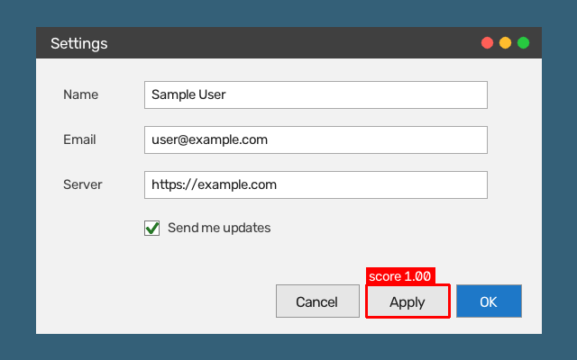

# screen-vision-utils

[](https://github.com/bhargavchintam/screen-vision-utils/actions/workflows/tests.yml)

Small Python tools to find things on a screenshot:

- **`locate`** finds where a small image (a button, an icon) appears on a screenshot, with OpenCV template matching. It prints the box and a match score, and it can draw the box on a copy of the screenshot.
- **`text`** lists the words in an image with their boxes, with the Google Cloud Vision API.

This helps with UI automation and testing: find a button on the screen, then click its centre.



## Install

```bash
git clone https://github.com/bhargavchintam/screen-vision-utils.git
cd screen-vision-utils
python -m pip install .            # locate only: numpy and opencv-python-headless
python -m pip install ".[text]"    # also the text command: google-cloud-vision
```

Python 3.10 or newer.

## `locate`: find an image on a screenshot

```bash
python -m screen_vision locate screenshot.png button.png --out found.png
```

This is the real output for the demo picture above:

```text
left=406 top=316 width=93 height=37 center_x=452 center_y=334 score=1.0000
```

- The numbers are screenshot pixels. `left` and `top` are the top-left corner of the best match.
- The score comes from `cv2.TM_CCOEFF_NORMED` on grayscale copies of both images. An exact copy scores close to 1.
- `--min-score` (default 0.9): if the best score is lower, the command prints `no match` and exits with code 1. With `--out` it still writes the picture, so you can see its best guess.
- Exit codes: 0 found, 1 no match, 2 error (for example a file that cannot be read).
- Template matching looks for the template at the same size and angle. If one image was taken at a different display scale (for example a HiDPI screenshot and a template cut at 1x), crop the template from a screenshot taken the same way.

The demo picture is made by `python scripts/make_demo.py`. It draws the settings window, crops the Apply button as the template ([docs/demo-template.png](docs/demo-template.png)) and runs the real `locate` command with `--out docs/demo.png`.

## `text`: find words and their boxes

```bash
export GOOGLE_APPLICATION_CREDENTIALS=/path/to/service-account-key.json
python -m screen_vision text screenshot.png
python -m screen_vision text screenshot.png --find Apply
```

Each output line is one word and its box, in the same style as `locate`: `text='Apply' left=… top=… width=… height=… center_x=… center_y=…`. With `--find`, only exact matches of that word are printed, and the exit code is 1 when there are none.

Setup:

- You need a Google Cloud project with the Vision API turned on, and a service-account key file (JSON) for it.
- Set `GOOGLE_APPLICATION_CREDENTIALS` to the path of the key file. The command stops with a clear error if the variable is not set or does not point to a file.
- Keep the key file outside this repository and never commit it. The `.gitignore` ignores `*.json` files for this reason.
- Vision API calls may be billed to your Google Cloud project.

## Python API

```python
import cv2
from screen_vision import draw_match, locate

screen = cv2.imread("screenshot.png")
button = cv2.imread("button.png")
match = locate(screen, button)
print(match.left, match.top, match.width, match.height, match.score)
x, y = match.center
cv2.imwrite("found.png", draw_match(screen, match))
```

```python
from screen_vision.text import detect_text, find_text

boxes = detect_text("screenshot.png")  # needs GOOGLE_APPLICATION_CREDENTIALS
for box in find_text(boxes, "Apply"):
    print(box.bbox, box.center)
```

## Tests

```bash
uv run --no-project --with opencv-python-headless --with numpy --with pytest pytest
```

The tests draw their own images with numpy and OpenCV, so they need no files, no network and no Google Cloud account. The one test that uses the real Vision client types is skipped unless `google-cloud-vision` is installed. CI ([tests.yml](.github/workflows/tests.yml)) runs pytest on Python 3.10, 3.12 and 3.13, with the `text` extra installed.

## Where this came from

This package joins two small scripts I wrote in 2022. Their old repos are now private:

- `detect-text-coordinates-in-image`: text coordinates from an image with the Google Cloud Vision API. It became `screen_vision.text`.
- `detect-image-coordinates-from-window-screenshot`: an image's coordinates on a window screenshot with OpenCV template matching. It became `screen_vision.locate`.

Compared with those scripts, this package adds one command line for both, results as small data classes instead of prints, a minimum score, a picture with the found box, clear errors for missing files and credentials, and tests.

## License

MIT, see [LICENSE](LICENSE). To contribute, see [CONTRIBUTING.md](CONTRIBUTING.md).
